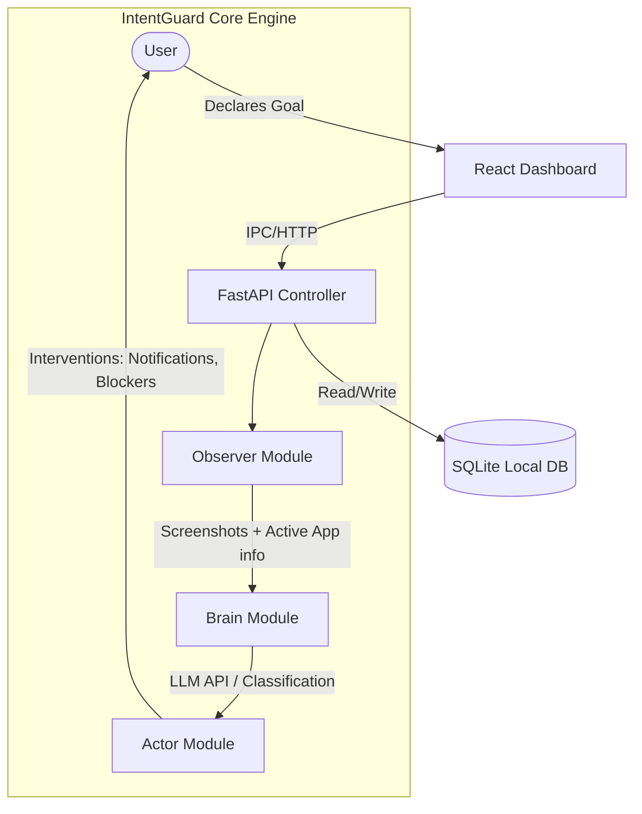

# System Architecture - IntentGuard

## System Overview
IntentGuard runs locally on macOS as a background service (FastAPI) paired with a menu bar icon and a local web dashboard (React). It observes user activity, evaluates focus state via a localized AI agent loop, and acts to prevent distractions.



---

## Codebase Directory Structure
```text
intentguard/
├── AGENTS.md
├── aicontext.md
├── ARCHITECTURE.md
├── PROGRESS_LOG.md
├── ROADMAP.md
├── SCRATCH.md
├── .env.example
├── tasks/
│   ├── TASK_TEMPLATE.md
│   └── 2026-06-12_phase-0-setup.md
├── observer/
│   └── __init__.py
├── brain/
│   └── __init__.py
├── actor/
│   └── __init__.py
├── storage/
│   └── __init__.py
└── dashboard/
```

---

## Core Components

### 1. Observer
* **Responsibility**: Screen capturing and active window tracking.
* **Mechanism**: Uses `mss` for lightweight screenshots and `pyobjc` to interface with the macOS Cocoa APIs to get the active window title and application name.

### 2. Brain
* **Responsibility**: Prompt engineering, context building, and LLM classification.
* **Mechanism**: Takes screenshots, active application details, and the user's declared goal. Queries Gemini or Anthropic API to classify the user's current status:
  * `ON_TASK`: Aligned with declared goal.
  * `DRIFTING`: Doing something unrelated or distracting.
  * `BREAK`: User explicitly declared a break session.

### 3. Actor
* **Responsibility**: System intervention.
* **Mechanism**: Triggers UI interventions based on user-defined aggressiveness levels (0-100%):
  * **Low (0-30)**: macOS system notifications via `pync`.
  * **Medium (31-70)**: Custom full-screen prompt overlay demanding verification.
  * **High (71-100)**: Simulates window closure or blocks focus apps using AppleScript/macOS system configurations.

### 4. Storage
* **Responsibility**: Local SQLite database storage.
* **Data Logged**: Session logs, classification history, activity timelines, and past quotes written by the user.

### 5. Dashboard
* **Responsibility**: User configuration and post-session analysis.
* **Mechanism**: React single page application communicating with the FastAPI controller.

---

## macOS Permissions Required
Because IntentGuard captures screen data and queries window names, macOS security policies require explicit user authorization:

1. **Screen Recording**: Under *System Settings > Privacy & Security > Screen Recording*. Required by `mss` to take screenshots.
2. **Accessibility**: Under *System Settings > Privacy & Security > Accessibility*. Required by `pyobjc` to poll active window metadata and titles.

---

## Local Development & Environment Setup

1. **Clone & Setup Environment**:
   ```bash
   cp .env.example .env
   # Add your GEMINI_API_KEY or ANTHROPIC_API_KEY to .env
   ```

2. **Backend Setup (FastAPI)**:
   ```bash
   pip install -r requirements.txt # containing fastapi, uvicorn, mss, Pillow, pyobjc, pync, google-generativeai
   python -m uvicorn main:app --reload
   ```

3. **Frontend Setup (React/Vite)**:
   ```bash
   cd dashboard
   npm install
   npm run dev
   ```
